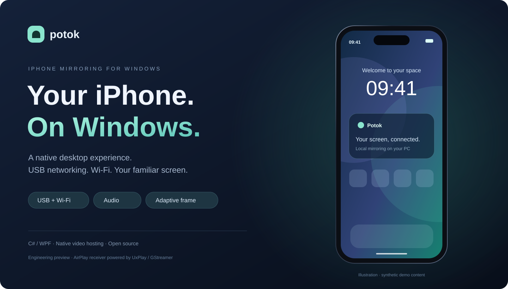
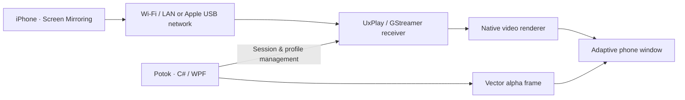

<div align="center">



# Potok · Поток

**Local iPhone screen mirroring for Windows — with audio and a phone-shaped window.**

[Download Windows x64 preview](https://github.com/Lill221/potok-iphone-mirror/releases/tag/v0.3.2-preview) · [Русский](README.ru.md) · [Quick start](docs/GETTING_STARTED.md) · [Engineering case study](docs/PORTFOLIO.md)


</div>

Potok brings the iPhone's built-in **Screen Mirroring** experience to a native Windows interface. Connect through a local network or Apple's USB network, hear phone audio on the PC, and view the stream inside an adaptive phone frame.

> **An early preview, not a universal compatibility promise.** USB and local-network mirroring were manually tested with iPhone 17 / iOS 27 on Windows 10. Windows 11 is a target platform; broader validation is still needed. Artwork above is a UI illustration with synthetic content, not a captured phone session.

## What it does

| Feature | Current state |
| --- | --- |
| **USB networking + Wi-Fi** | Verified local mirroring paths; no internet relay |
| **Phone audio** | Supported by the receiver and tested in the initial setup |
| **Adaptive phone window** | Stream-driven aspect ratio, portrait/landscape handling, resize and always-on-top |
| **Smooth device frame** | Alpha-composited vector border; optional decorative Dynamic Island |
| **Quality profiles** | 1080p60, 720p60, 1080p30 requests; experimental higher-detail HEVC profiles |
| **Diagnostics** | Actual USB/LAN connection path and iPhone-reported frame telemetry |
| **Mouse / touchpad** | Experimental BLE HID module; requires peripheral-capable Bluetooth and AssistiveTouch; live phone control not yet validated |

## Download & run

1. Download **Potok-0.3.2-preview-win-x64.zip** from [Releases](https://github.com/Lill221/potok-iphone-mirror/releases/tag/v0.3.2-preview).
2. Extract the entire ZIP and open **PhoneMirror.exe**. The portable build includes .NET; no developer SDK is needed.
3. Click **Начать трансляцию**. First run offers a separate download of the pinned **UxPlay Windows receiver** from its upstream GitHub release (about 110 MB). The hash is checked before extraction. Discovery-service setup may request administrator approval.
4. On iPhone, open **Control Center → Screen Mirroring → Potok**.

For Wi-Fi, connect both devices to the same router; the PC may use Ethernet. For USB, install **Apple Devices** separately, trust the PC and enable **Personal Hotspot**. An active Apple USB Ethernet adapter is required. This uses AirPlay **over a USB network**, not raw USB video capture. See the [setup guide](docs/GETTING_STARTED.md).

**Requirements:** Windows 10 2004+ / Windows 11 x64, iPhone with compatible AirPlay mirroring, local network access. Developer Mode and an iOS companion app are not required for mirroring. The UI is currently Russian. This preview is unsigned.

## Designed around the screen

- Resize without stretching the image. Dimensions follow the incoming video stream.
- Move the phone window by its frame; right-click for always-on-top and appearance controls.
- Keep the iPhone's real Dynamic Island visible. The additional decorative overlay is optional.
- Close the phone-shaped window to return the receiver's standalone video window; close the main app to stop the managed session.

1080p60 and HEVC values are **requested settings**, not guaranteed negotiated resolution or measured display FPS. CPU decoding is the compatibility default; GPU mode remains experimental after a negotiation failure on the test PC. Sender telemetry is not an end-to-end latency benchmark.

## Under the hood



Potok implements the Windows UI, process/configuration management, native video-window integration, frame geometry, diagnostics, and an experimental input module. **AirPlay and media decoding are provided by UxPlay / GStreamer; Apple provides the device/network drivers.** The smooth frame is a separate alpha-composited vector layer; it does not recapture the desktop or re-encode video.

Read the [engineering case study](docs/PORTFOLIO.md) for design decisions, tradeoffs, validation and next steps.

## Build & test

Install the **.NET 8 SDK** on Windows, then:

```powershell
./scripts/build.ps1
./app/PhoneMirror.exe --self-test
./app/PhoneMirror.exe --native-host-test
./scripts/package.ps1
```

Packaging produces a self-contained Windows x64 ZIP and SHA-256 checksums under `dist/`. CI builds the portable package. Automated checks cover quality arguments, connection routes, telemetry parsing, HID report encoding, vector alpha at multiple DPI scales and native window integration. Real AirPlay compatibility still needs a physical device test.

## Limits & roadmap

- No universal iOS-version support guarantee or internet relay.
- Mouse input is a prototype and unavailable on adapters without **BLE peripheral** support; Bluetooth version alone is not enough.
- No multi-touch, measured end-to-end latency or broad hardware compatibility certification.
- Protected video may not mirror through an open-source receiver.
- Next: broader test matrix, validated input, rendered-FPS measurements, persisted settings and a signed installer.

## License & credits

Potok source: **GPL-3.0-only**, copyright © 2026 [Lill221](https://github.com/Lill221).

The release ZIP does not repackage the UxPlay/GStreamer media bundle or Apple drivers. The receiver is an optional, hash-pinned download from its upstream release. .NET runtime licenses/notices are retained in the self-contained build. See [third-party notices](THIRD_PARTY_NOTICES.md).

Thanks to [UxPlay](https://github.com/FDH2/UxPlay), [uxplay-windows](https://github.com/leapbtw/uxplay-windows), [GStreamer](https://gstreamer.freedesktop.org/) and the .NET/WPF ecosystem. This independent project is not affiliated with Apple or Microsoft.
