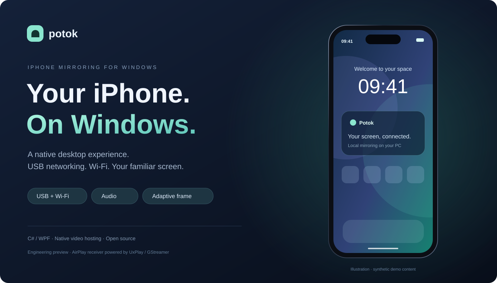

# Поток / Potok



**Экран iPhone на Windows: по локальной сети или USB-сети, со звуком и окном в форме телефона.**

[Скачать Windows x64](https://github.com/Lill221/potok-iphone-mirror/releases/tag/v0.3.2-preview) · [English](README.md) · [Быстрый запуск](docs/GETTING_STARTED.md) · [Разбор проекта для портфолио](docs/PORTFOLIO.md)

## Возможности

- **USB и Wi-Fi:** проверены на тестовом iPhone. ПК может подключаться к роутеру кабелем Ethernet.
- **Звук телефона на ПК.**
- **Окно iPhone:** адаптация к пропорциям потока и повороту, изменение размера, режим поверх окон.
- **Сглаженная рамка:** векторный слой с полупрозрачным краем. Настоящий Dynamic Island из трансляции сохраняется; дополнительный декоративный островок включается отдельно.
- **Профили качества:** запросы 1080p60 / 720p60 / 1080p30, экспериментальные HEVC 1440p60 / 2340p30.
- **Диагностика:** путь соединения USB/LAN и отчёты iPhone о кадрах.
- **Мышь:** экспериментальный BLE HID-тачпад; требует AssistiveTouch и Bluetooth-адаптера с поддержкой BLE peripheral. Реальное управление на подходящем оборудовании ещё не подтверждено.

## Как запустить

1. Скачай ZIP из [Releases](https://github.com/Lill221/potok-iphone-mirror/releases/tag/v0.3.2-preview) и полностью распакуй.
2. Открой **PhoneMirror.exe**. .NET включён в переносную сборку, SDK не нужен.
3. Нажми **«Начать трансляцию»**. При первом запуске приложение предложит скачать сторонний приёмник UxPlay с GitHub его разработчика (~110 МБ). Проверяется закреплённая SHA-256. Первичная настройка службы обнаружения может потребовать права администратора.
4. На iPhone выбери **«Пункт управления → Повтор экрана → Potok»**.

**Wi-Fi:** iPhone и ПК должны быть в одной сети роутера. Для проверки именно беспроводного пути отключи USB и режим модема.

**USB:** установи Apple Devices отдельно, подключи разблокированный iPhone, подтверди доверие ПК и включи «Режим модема». В Windows должен появиться активный Apple Mobile Device Ethernet. Это AirPlay через USB-сеть, а не собственный драйвер прямого USB-видеозахвата.

**Требования:** Windows 10 2004+ / Windows 11 x64. Для зеркалирования не нужны приложение на iPhone и режим разработчика. Интерфейс на русском. Сборка предварительная и без цифровой подписи.

## Управление окном

Перетаскивай за рамку. ПКМ по рамке открывает настройки оформления и режим поверх других окон. F11 увеличивает окно в рабочую область; Esc закрывает окно телефона. После смены профиля заново подключись к Potok на iPhone.

## Честно о готовности

Проверена конфигурация iPhone 17 / iOS 27 / Windows 10, USB и общая локальная сеть. Windows 11 — целевая платформа, широкого тестирования пока нет. Изменения iOS могут потребовать обновления приёмника.

Разрешение и FPS в профиле — запрос к телефону, не гарантия результата. CPU-декодирование выбрано основным после сбоя GPU на тестовом ПК. FPS в диагностике — отчёт отправителя, не измерение плавности отрисовки или сквозной задержки. HEVC и управление мышью экспериментальные. Иллюстрация на обложке содержит демонстрационные данные, а не личный экран телефона.

## Архитектура и авторство

Здесь реализованы собственные C# / WPF-интерфейс, управление сессией и настройками, native-встраивание окна видео, адаптивная рамка, диагностика и экспериментальный модуль ввода. Протокол AirPlay и декодирование предоставляет **UxPlay / GStreamer**; драйверы — Apple. Векторная рамка накладывается отдельным прозрачным слоем без повторного захвата экрана ПК.

## Сборка

Нужен .NET 8 SDK на Windows:

```powershell
./scripts/build.ps1
./app/PhoneMirror.exe --self-test
./app/PhoneMirror.exe --native-host-test
./scripts/package.ps1
```

Самодостаточный ZIP и контрольная сумма появляются в `dist/`. Не публикуй локальные `logs/`, личные скриншоты и данные устройств. При обращении с ошибкой сначала обезличь журнал.

## Лицензия

Собственный код — **GPL-3.0-only**, автор [Lill221](https://github.com/Lill221). Приёмник и Apple-драйверы не включены в наш ZIP; приёмник загружается отдельно из upstream-релиза. Подробности — [THIRD_PARTY_NOTICES.md](THIRD_PARTY_NOTICES.md).
